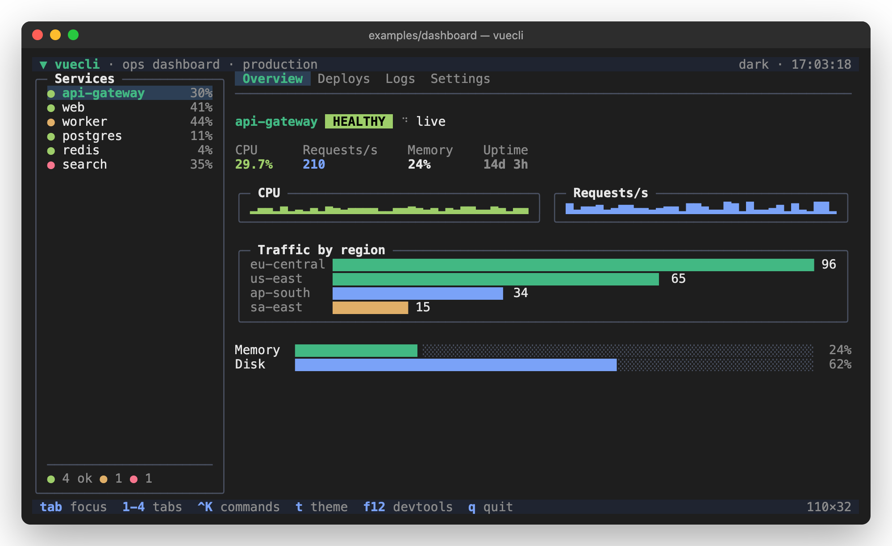
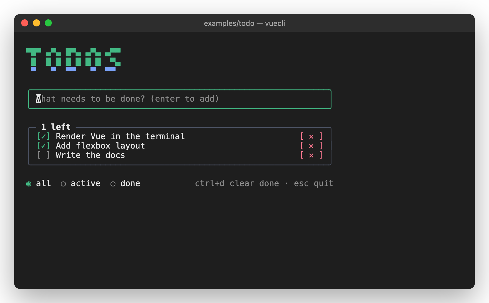
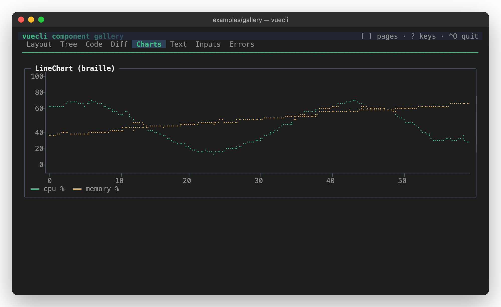
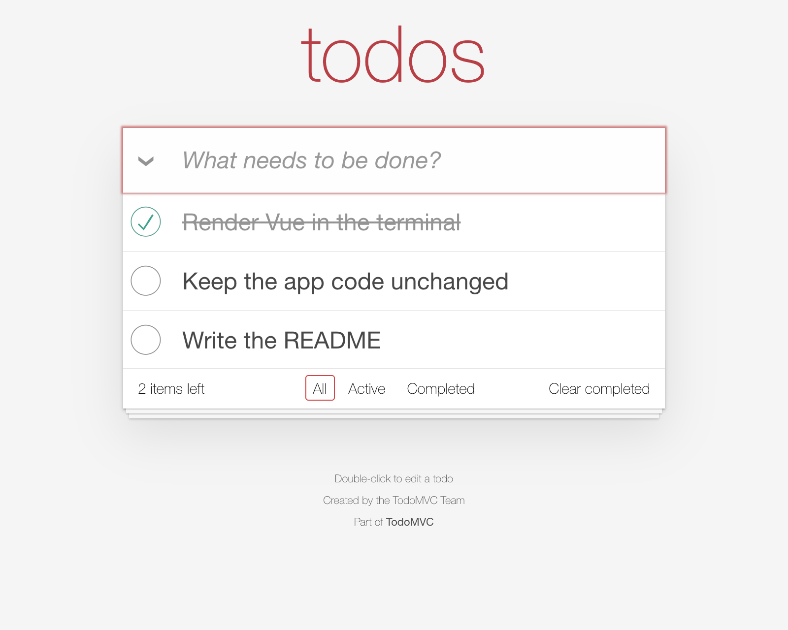
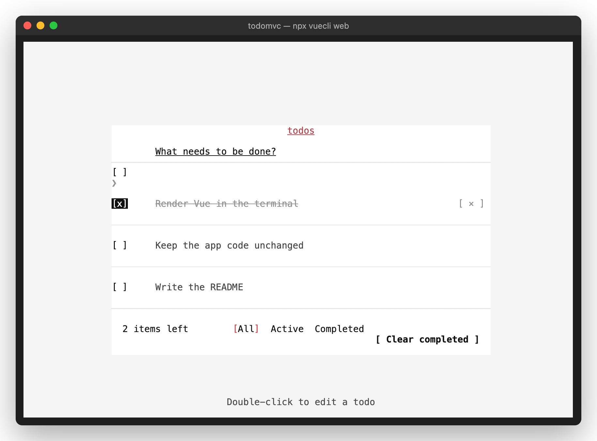
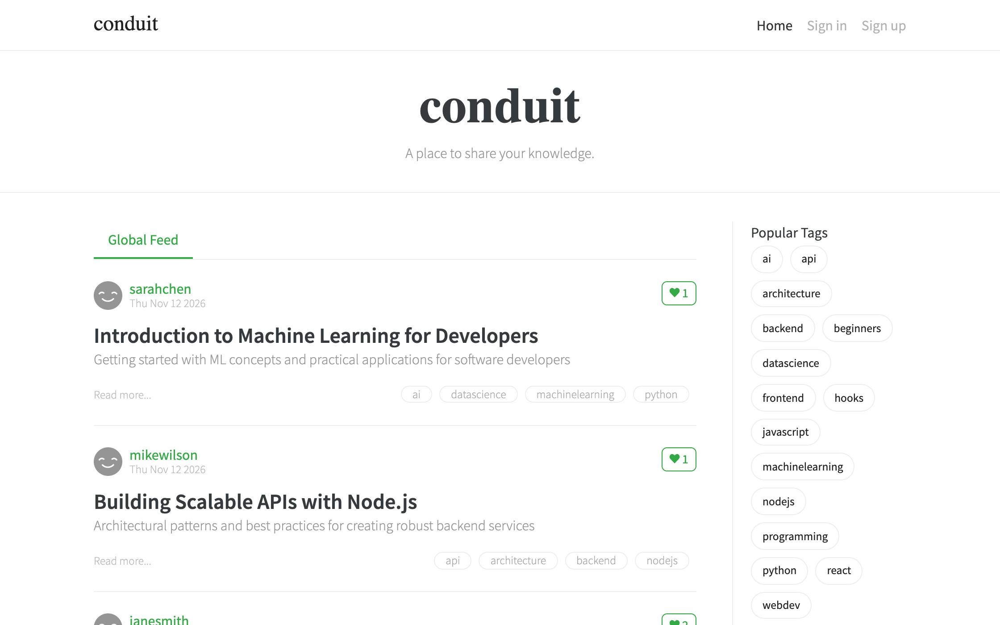
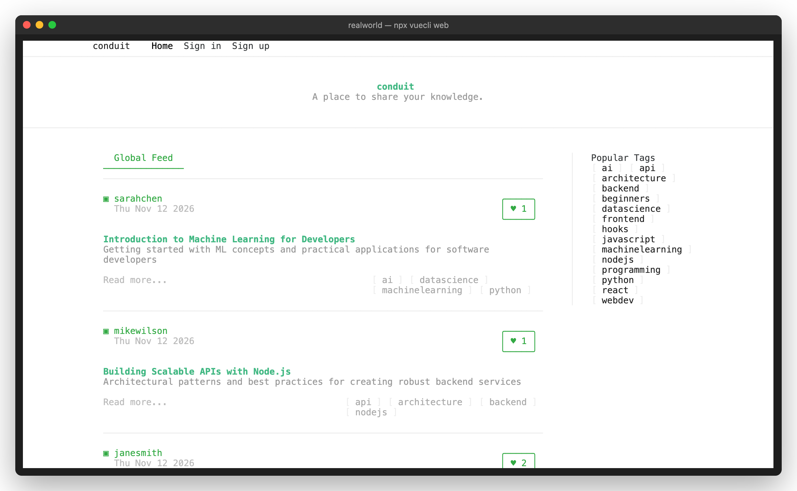
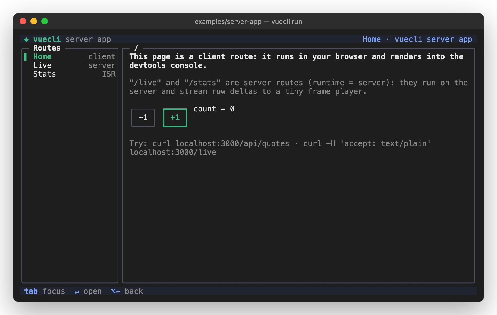
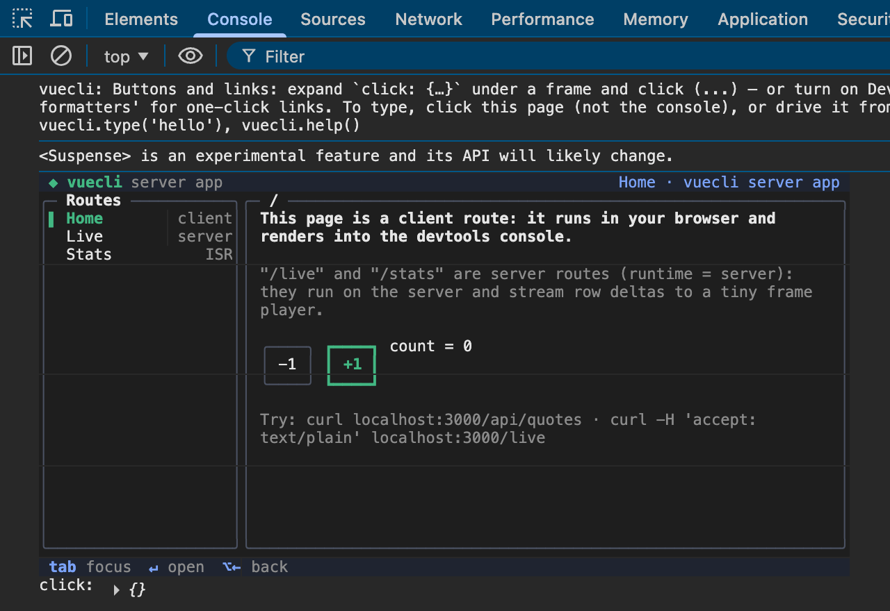

# vuecli

**Vue 3 in the terminal.** Write ordinary Vue components (SFCs, `<script setup>`, TypeScript,
`ref`, `computed`, `v-model`, slots, Teleport, Suspense) and they render as a real terminal
UI: flexbox layout, borders, colors, themes, keyboard focus and mouse support.



<sub>`npm run example:dashboard`, captured from a real terminal session.</sub>

- **Build terminal apps with Vue:** 49 components, a file-based App Router, a Canvas 2D API, themes, testing utilities.
- **Run existing Vue web apps in the terminal, unchanged:** `npx vuecli web` builds a Vite + Vue 3 app with its own config and renders it with its CSS, links, forms and router.
- **Run the same app in other places:** inside the browser devtools console, or streamed from a server.

## Quick start

Requires **Node.js 20.6+** and any modern terminal. vuecli isn't on npm yet: install it from a
checkout ([details](docs/GETTING-STARTED.md#install)), then:

```vue
<!-- App.vue -->
<template>
  <Box class="flex-col gap-1 p-1" border="round" title="counter">
    <BigText :text="String(count)" color="primary" />
    <Box class="gap-1">
      <Button label="-1" @click="count--" />
      <Button label="+1" variant="primary" @click="count++" />
    </Box>
  </Box>
</template>

<script setup lang="ts">
import { ref } from 'vue'
const count = ref(0)
</script>
```

```sh
npx vuecli App.vue            # Tab / Enter / mouse, Ctrl+C quits
npx vuecli create my-app      # or start a project with routes
```

More in **[Getting started](docs/GETTING-STARTED.md)**: the examples, every CLI flag and
troubleshooting.

## Examples

<table>
  <tr>
    <td width="50%"></td>
    <td width="50%"></td>
  </tr>
  <tr>
    <td align="center"><sub><code>npm run example:todo</code></sub></td>
    <td align="center"><sub><code>npm run example:gallery</code> (Charts page)</sub></td>
  </tr>
</table>

## Existing web apps in the terminal

```sh
cd my-vite-vue-app
npx vuecli web
```

<table>
  <tr>
    <th width="50%">In the browser (<code>npm run dev</code>)</th>
    <th width="50%">In the terminal (<code>npx vuecli web</code>)</th>
  </tr>
  <tr>
    <td></td>
    <td></td>
  </tr>
  <tr>
    <td></td>
    <td></td>
  </tr>
</table>

<sub>TodoMVC's Vue example and [Conduit](https://github.com/mutoe/vue3-realworld-example-app)
(live data from the public RealWorld API), both unmodified.</sub>

What works (Tailwind v3/v4, vue-router, Pinia, VueUse, component libraries, browser APIs)
and what doesn't is listed in **[Compatibility](docs/COMPATIBILITY.md)**. The app runs in
Node, outside the browser sandbox: read the **[security note](docs/SECURITY.md#running-existing-web-apps-vuecli-web)**
first. Details: [docs/WEB.md](docs/WEB.md).

## In the browser devtools console

<table>
  <tr>
    <th width="50%">In the terminal (<code>vuecli run</code>)</th>
    <th width="50%">In the Chrome devtools console (<code>vuecli dev</code>)</th>
  </tr>
  <tr>
    <td></td>
    <td></td>
  </tr>
</table>

The same `.vue` code renders into the devtools console (buttons and links are clickable
there), or streams from a server to a 5.6 kB player. See
[Browser, server and deployment](docs/SERVER.md).

## Documentation

| | |
| --- | --- |
| [Getting started](docs/GETTING-STARTED.md) | install, first app, examples, CLI reference, troubleshooting |
| [Building apps](docs/GUIDE.md) | layout and styling, components, composables, input, themes, router, canvas, testing |
| [Existing web apps](docs/WEB.md) | `vuecli web` in detail |
| [Browser, server and deployment](docs/SERVER.md) | console target, server routes, adapters |
| [Compatibility](docs/COMPATIBILITY.md) | Node, terminals, web apps, CSS, libraries, known gaps |
| [Security](docs/SECURITY.md) | trust model, safe defaults, deployment, files written |
| [Error codes](docs/errors.md) | every `VC###` error with a fix |

All pages: [docs/](docs/README.md).

## Safe and compatible by default

- **Untrusted text can't control your terminal.** Control characters and escape sequences in app data, logs and titles are removed or shown as visible escapes.
- **The dev server only listens on localhost** and rejects DNS-rebinding requests; production responses never contain stack traces.
- **Your terminal is always restored:** on Ctrl+C, crashes, `kill` and closed windows.
- **Works everywhere text works:** truecolor down to 16 colors and `NO_COLOR`, any size, and `--snapshot` when there's no terminal at all (CI, pipes).

## Development

```sh
git clone https://github.com/marcuspuchalla/vuecli.git && cd vuecli
npm install         # installs and builds
npm test            # vitest (root suite)
npm run test:all    # root suite + every package (tty-canvas, eslint plugin, VS Code, DevTools)
npm run typecheck
```

How the code fits together: [docs/ARCHITECTURE.md](docs/ARCHITECTURE.md). Security issues:
see [SECURITY.md](SECURITY.md).

## Why vuecli

I recently saw a tool on Hacker News that lets React apps run on the command line, and I
thought Vue apps deserved the same. I'm a big fan of Vue: I find it much more pleasant to
read and to work with than React. So I built vuecli, and I'm really happy with how it has
turned out so far. It was built in collaboration with AI coding agents.

## Contributing

Contributions are very welcome: bug reports, web apps that don't render right yet,
components, examples and docs. Start with **[CONTRIBUTING.md](CONTRIBUTING.md)**.

## License

[GNU General Public License v3.0 or later](LICENSE) (GPL-3.0-or-later). The bundled FIGlet fonts keep
their own New BSD License (see `src/fonts/`).
