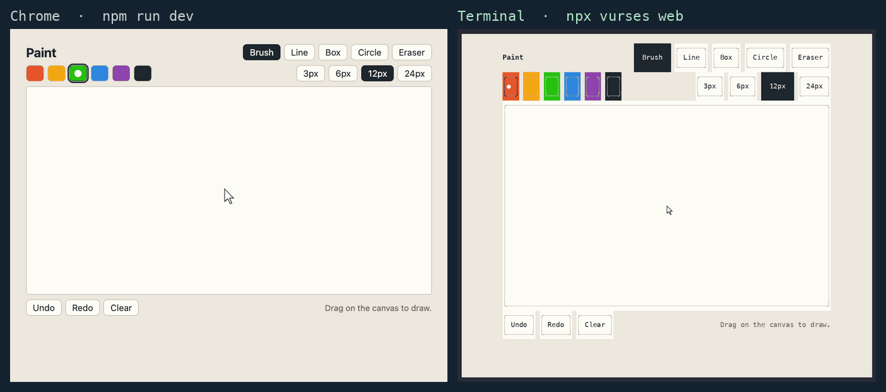

# Paint, in the browser and in the terminal

A small paint app built on [vue-drawing-canvas](https://github.com/razztyfication/vue-drawing-canvas)
(MIT, by Toni Oktoro): brush, line, box and circle tools, colours, brush sizes, eraser, undo and
redo. It's an ordinary Vite + Vue 3 app; nothing in it knows about the terminal.



```sh
npx degit marcuspuchalla/vurses/examples/web-paint paint && cd paint
npm install
npx vurses web      # in the terminal; `npm run dev` opens it in the browser
```

Draw by dragging with the mouse. In the terminal the canvas is shown with block characters
(2 × 2 pixels per cell), so thin lines look coarser than in a browser.
